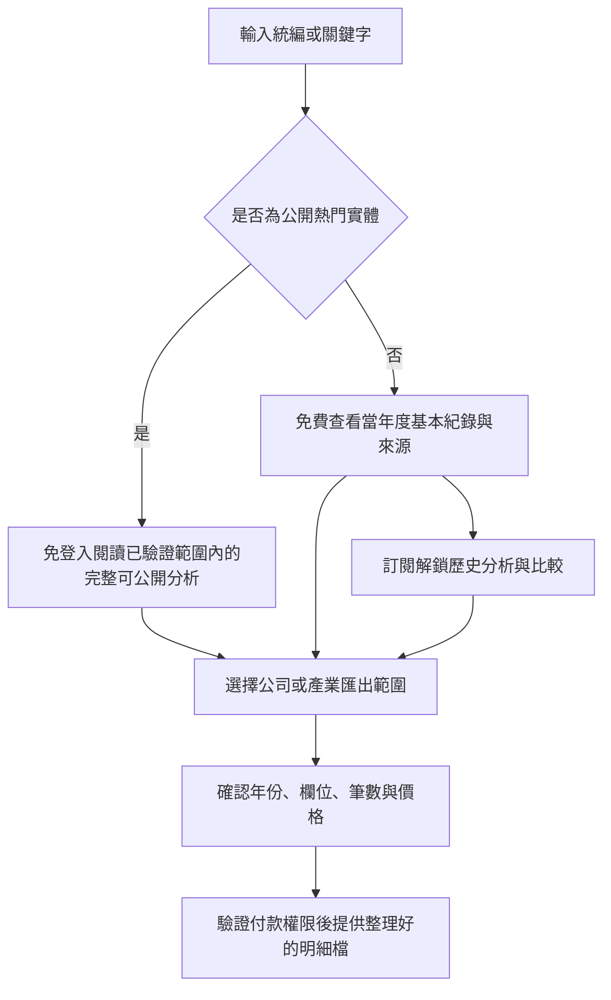

# 台灣公共資金流向戰情室：商業計畫

Taiwan Public Funds Intelligence｜方向決策：2026-10-25

本文件記錄商業模式、定價與市場假設；產品行為、資料語意、介面及架構的詳細要求見[產品需求](PRODUCT_REQUIREMENTS.md)。代理工作與通用工程流程由 [AGENTS.md](../AGENTS.md) 管理。

## 一、定位與價值

把台灣政府採購決標與中央、地方機關對民間組織的補助資料串在一起，讓企業用統編、組織名稱、機關或產業查詢公共資金相關紀錄，縮短蒐集、對照與整理資料的時間。

主要付費者是中小企業、業務團隊與研究機構，因此定位是「服務政府市場的 B2B 商業情報平台」。記者與一般讀者使用公開專題，政府並非目前假定的採購客戶。

核心商業假設是：公開熱門案例能展示資料深度，吸引其中有企業研究需求的人，為其他組織的完整研究與便利匯出付費。這是本產品要驗證的模式，並非已證實的轉換或獲利結果。

## 二、熱門免費、深度研究付費

| 情境 | 免費內容 | 付費內容 |
| --- | --- | --- |
| 公開熱門企業或團體 | 已驗證範圍內可公開的歷史、機關分布、採購與補助分析，不需登入 | 整理好的公司或產業明細匯出 |
| 其他企業或團體 | 當年度基本紀錄、資料截至日、來源與覆蓋說明 | 跨年度歷史、可比案件分析、機關分布與明細匯出 |
| 沒有資料或身分不確定 | 明確顯示尚未收錄、資料缺漏或需要辨識 | 不以不存在的資料誘導購買 |

「完整」僅指平台已驗證且可公開的範圍，不代表所有政府支出已收齊。一般實體在當年度查無紀錄時，不以舊資料冒充當年資料，也不將查無紀錄解讀成從未獲得公共資金。

熱門資格由全站一致的公開議題規則決定，保存來源、選入理由、審核及有效期間。可用新聞與彙總搜尋趨勢作為候選訊號，但公開前需確認實體身分與資料。熱門不等於涉案，更不等於違法。首版不設定未驗證的自動流量門檻，也不按個人瀏覽紀錄改變免費範圍。

專題會標示免費期間及政策版本；期滿後的一般頁依同一公開規則處理。已公開、可引用的專題快照保留其日期、來源與更正紀錄，不把曾經免費的內容當作能完全收回的秘密。

付費價值來自清理、跨來源對照、可比分析、版本追溯與匯出便利。免費資訊可被閱讀及複製，不能宣稱靠下載按鈕就能封鎖所有資料取得方式。

## 三、不使用個人化功能的首版

首版提供統一搜尋、產業／機關／年度篩選、企業與團體資料頁、全站熱門專題，以及按次購買匯出。篩選只改變當次查詢；不建立個人輪廓。同一版本與權限的使用者看到相同內容。

不納入收藏、監控名單、儲存搜尋、個人推薦、LINE／Email 提醒、CRM、私人企劃書上傳或 AI 評委偏好診斷。原提案的 NT$299／月、監控五個實體方案因此移出首版。

付款可以保留必要的交易與授權資料，讓使用者取回已購內容；這不延伸成行為推薦。免費閱讀免登入，付費採最小必要驗證。交易信件若有必要，只處理收據與交付，不作為個人化商機通知。

## 四、客群與可交付的情報

| 客群 | 要解決的工作 | 可提供的證據與成果 |
| --- | --- | --- |
| 中小企業主、業務主管 | 評估一個機關或市場是否值得投入 | 對手公開決標紀錄、機關採購分布、同類案件金額及時間變化 |
| B2B 業務與研究團隊 | 整理有政府業務或補助紀錄的組織 | 帶統編／實體辨識、來源、日期與金額類型的名單匯出 |
| 會計師、投資及研究機構 | 查核組織的公共部門業務線索 | 跨年度紀錄、來源更正、可重現統計與資料覆蓋限制 |
| 記者與一般讀者 | 理解公共議題涉及的採購及補助 | 免登入專題、可引用圖表、明細來源及資料方法 |

「拿到標案」不等於已收現金，也不等於當期認列營收。資料支援研究，不保證中標率、投資結果或未來補助。

首版圖表的定義如下；只有來源足夠時才顯示。

| 圖表或指標 | 定義與必要資料 | 解讀限制 |
| --- | --- | --- |
| 年度公告金額與件數 | 依明確的決標日或核准日，分列採購決標與補助核定 | 當年資料標示截至日；缺年不補零；合約總額不攤成假想年收入 |
| 機關分布 | 同一金額類型、期間與去重規則下，各機關金額及件數占比 | 顯示樣本與覆蓋；不能推論私人關係或偏好 |
| 決標金額／預算金額 | 同案、同範圍、同幣別，且預算大於零時的比值 | 不等同底價折讓、投標價格、利潤或應採用的報價 |
| 可比案件分布 | 依採購類別、方式、期間及案件範圍分組，呈現分布與樣本數 | 不混合不可比較案件；稀少樣本不下策略結論 |
| 公告關聯桑基圖 | 機關、計畫與組織之間有來源支持的公告金額關聯 | 分開決標、核定與支付，不把兩種金額直接加為總收款 |
| 合約期限與公開機會 | 已公開履約期限、採購預告與補助公告 | 屆期只代表可能需要再觀察，不代表必然續約或下月開放補助 |

投標勝率必須有可驗證的投標總數與落標紀錄。只有得標公告時，顯示得標件數，不顯示勝率。首版以機關與案件層級的客觀分析取代「評委偏好」，不建立個人評委評分，也不從共同出現推論合作或政治關係。

## 五、定價與交付範圍

下列金額沿用使用者提案，屬於市場測試價格，尚未啟用收費。

| 方案 | 提案價格 | 首版權益 |
| --- | --- | --- |
| 公開閱讀 | 免費 | 熱門實體完整可公開分析；其他實體當年度基本資料 |
| 專業訂閱 | NT$999／月，或 NT$7,990／年 | 已收錄一般實體的歷史分析與可用比較；不另按網頁查詢次數收費 |
| 單次匯出 | NT$499／次 | 結帳前確認的一個公司或產業查詢範圍、資料版本與日期區間之 Excel 明細 |

為釐清原案未定義的「尊榮會員」，首版先不設這個方案。專業訂閱解鎖網頁研究，匯出另行計費；未來是否改為含額度方案，依市場驗證決定。一般訂閱不因此包含無限制的大量下載或 API。

匯出前顯示實際筆數、欄位、年份、缺漏與一份不洩露受限內容的格式樣本。付款後交付同一版本的檔案與來源說明；下載期限、重試、退款及稅務顯示方式須在正式結帳條款內確定。

「十年歷史」是資料覆蓋目標。原提案的 2020–2026 僅涵蓋七個曆年，且 2026 年截至本次決策日仍未結束；不能當成十年完整資料。商品年份應由資料版本產生，不把固定年份寫成永久承諾。

## 六、借鏡國際產品

以下引用第一手產品或組織資料，查閱日期均為 2026-10-25。產品宣傳及企業自報數據，不等同獨立成效審計。

| 產品 | 可查證的做法 | 本專案採用的方向 | 不能直接推論的結論 |
| --- | --- | --- | --- |
| OpenTheBooks | 以公共支出資料庫與調查報導推動透明；屬 American Transparency 的非營利專案。[官方介紹](https://www.openthebooks.com/about-us/) | 用可引用的公開議題與來源完整的圖表建立信任及觸及 | 非營利曝光不證明企業訂閱轉換或低維護成本 |
| Deltek GovWin IQ | 結合分析師研究與採購情報；官方說明部分機會可早於招標公告數年識別。[產品介紹](https://www.deltek.com/products/govwin/)、[提前情報說明](https://www.deltek.com/resources/articles/deltek-business-development-growth-ai/) | 提供可追溯的合約期限、預算與公開公告，減少企業研究工時 | 歷史決標資料本身不能可靠預測下一輪補助；本次查閱的官方頁面不足以確認「平均年費 US$29,000」 |
| GovDash | 將機會發現、投標及合約管理串成工作流程。[官方融資公告](https://www.govdash.com/blog/press-govdash-raises-30m-series-b-to-help-companies-win-and-manage-government-contracts-with-ai) | 優先交付能直接使用的結構化明細與來源包 | 融資不代表獲利，也不能證明台灣市場或本產品付費牆成立；首版不複製其個人化與私有文件流程 |

OpenTheBooks 官網自報年預算約 US$270 萬；其 [2023 年報](https://www.openthebooks.com/assets/1/6/AR_otb.com_final2.pdf) 記載 2024 年初推出 Benjamin。這些可以說明其資料敘事工具，不能直接作為本平台成本估算。

Deltek 確有「最早可提前五年」的產品主張，但其說明包含分析師向政府端蒐集與確認情報。這不是只靠公開 CSV 就能複製的確定預測能力。

GovDash 於 2026 年 1 月公告 US$3,000 萬 B 輪融資，並自報自 A 輪以來營收成長 16 倍。這支持觀察「減少投標工作時間」的產品價值，不能拿來宣稱本案已獲市場驗證，或把 24 小時交付視為所有客戶的保證。

本次沒有找到上述產品採用同一種「熱門企業全免費、冷門企業付費」策略的第一手證據。借鏡的是公開資料敘事、研究深度與工作成果；本案的付費邊界仍須自行驗證。

## 七、台灣資料與可信度

資料來源以政府電子採購網、政府資料開放平臺與各機關正式揭露為起點。先盤點可取得範圍，再決定上架年份與機關，不能假設存在完整的中央地方統一 API。

兩個官方資料集說明了需要逐一確認覆蓋的原因：

- 工程會的[巨額採購履約廠商名單](https://data.gov.tw/dataset/7264)標示只涵蓋近一週公告且仍在履約的巨額採購廠商，不是全部歷史決標。
- 勞動力發展署的[民間團體及個人補捐助季報](https://data.gov.tw/dataset/143623)提供特定機關、特定期間的資料，金額欄位可能含累計金額，不能直接跨季相加。

上述僅為來源盤點例子，並未匯入產品。查閱的是 2026-10-25 可取得的官方詮釋資料；原始檔內容、完整年份、缺漏與實際更新情況仍需逐檔驗證。來源資料含個人受補助者時，首版僅納入組織，不建立個人受助名冊。

資料方法需要保留原始版本、來源欄位、統編與名稱別名、更正撤銷、複數決標及無法確定的實體對應。展示資料時，同時附上幣別、單位、日期基準、來源、版本與缺漏，不將「未收錄」寫成「零」。

標案預算、決標金額、補助核定額與實際支付額分開保存及展示。來源不足以排除跨來源重複時，不提供相加總額。爭議專題使用可查核描述，保留更正管道，不以「神祕」「涉案」等字眼代替證據。

## 八、成長與成本假設

成長方式採公開資料專題、產業分析及可被引用的圖表。例如「某產業的採購機關分布」「補助公告涵蓋哪些組織類型」，讓讀者能追溯原始文件。時事可以提供切入點，但不承諾每次事件發生後一小時內完成可靠報導，也不把社群熱度當成商業成交。

週報可整理全站共同議題，作為公開網頁由讀者自行閱讀；不變成個人化推播。是否對外發布與使用哪個社群帳號，另依發布授權處理。

商業驗證分開觀察熱門頁觸及、一般企業查詢、付費意圖、實際交易、退款與續訂。使用匿名彙總結果，不建立跨站個人追蹤。測試前先記錄樣本、期間與採納門檻，避免把事後挑選的流量當成成功證據。

主要成本包括資料取得及授權、格式變動、實體比對、人工校對、更正處理、付款手續費、雲端、客服與內容編輯。靜態頁面可減少部分運算，但無法證明總維護成本極低。收益評估需納入這些成本，以及年繳折扣與退款；目前不提供無依據的營收預測。

## 九、架構與產品交付界線

公開介紹、專題與允許公開的資料採靜態輸出，昂貴的資料清理及彙總預先完成，目標部署於 Cloudflare。實際產品選擇、建置命令及輸出目錄隨實作確認。

真實付費牆需要最小的伺服器端授權、支付驗證與私有匯出服務。未授權的歷史資料不能先放入公開 JSON 再用 CSS 遮罩；公共快取也不能混入不同購買權限的內容。若目前僅有靜態示範，需清楚標示示範並停止真實收款。

首版至少讓讀者完成「搜尋實體、理解金額與來源、看懂免費／付費界線、取得授權範圍內的分析與匯出」。圖表需有表格替代、鍵盤操作及手機版，並清楚顯示空值、部分年份與資料截至日。

待交付工作以 GitHub 為準：[來源與資料方法 #7](https://github.com/x168/dulan/issues/7)、[非個人化 MVP #8](https://github.com/x168/dulan/issues/8)、[市場與成本驗證 #9](https://github.com/x168/dulan/issues/9)。工程驗證設施由 [#2](https://github.com/x168/dulan/issues/2) 追蹤。本文件記錄產品選擇，不代替工作佇列或驗證證據。
